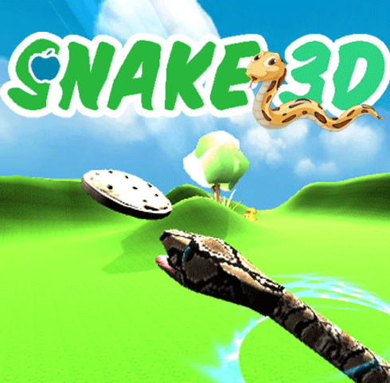

# Snake3D

A 2016 virtual-reality Snake project by **Sapir Eltanani and Simona Gluzman**, supervised by **Aaron Wetzler** in the Technion Geometric Image Processing Laboratory.

According to the report, hand movement controls a snake in a three-dimensional environment. Collecting food increases its score and length; colliding with the snake's body or surrounding objects ends the game. The report describes Unity/C# development, Leap Motion and RealSense hand input, Oculus Rift viewing, and a dynamically generated body mesh following a B-spline path. These descriptions come from the original materials; the application has not been run during this recovery.

*The image above is the unchanged artwork from the official project page, not a newly produced runtime result.*

## Available materials

- [Project report](docs/report.pdf): the original six-page PDF, recovered from an archived copy of the GIP website. It includes the reported implementation approach and historical screenshots.
- [Final presentation on YouTube](https://www.youtube.com/watch?v=6O5-z4Ul1i8): the video linked by the official project page. The video is externally hosted, is not bundled here, and was not checked for current playback.
- [Project entry on Aaron Wetzler’s website](https://twerdster.github.io/#snake3d).
- [Official GIP project page](https://gip.cs.technion.ac.il/last-projects-2016-6.html).
- [Recovery sources, dates and hashes](docs/source-provenance.json), with [material review](docs/material-review.json).

The official report download returned HTTP 404 when checked on November 15, 2026. The copy here preserves the original PDF bytes from the Internet Archive's September 19, 2017 capture; it is not a rewritten report.

## Date and recognition

The GIP project record is from **2016**, consistent with the report's June 2016 metadata. The precise project completion date is not established by these records.

The Technion faculty [announcement dated July 4, 2017](https://www.cs.technion.ac.il/news/view-new.php?nwid=944) records a **special citation certificate** for Sapir Eltanani and Simona Gluzman's Snake 3D project, supervised by Aaron Wetzler. The ceremony took place on July 3, 2017. This recognition is separate from the Amdocs Best Project awards listed in the same notice.

## Archival status

This repository contains project documentation, an image and provenance records. No original Unity project, C# implementation, executable or SDK package was recovered in the scoped public search. There is no software installation procedure or modernized application here. No build, gameplay, VR-device compatibility or performance check was performed.

This project is unrelated to the 2010 **Snake Game 3D** by Amir Blum and to other similarly named games.

## Attribution and reuse

The report and artwork retain their original authorship and applicable terms. No explicit general reuse license was found in the recovered materials; this repository does not assign a blanket software or asset license. Third-party tools, SDKs and any future source contribution require their own licensing review.

The credits follow the official GIP record. The original authors can submit missing materials or corrections through issues or pull requests.
