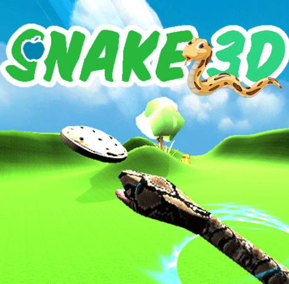

# Snake3D

Snake3D was a 2016 virtual-reality Snake project: hand movement steered a snake through a three-dimensional environment while collecting food and avoiding collisions. The report describes Unity/C#, Leap Motion, RealSense and Oculus Rift.

Original project: **Sapir Eltanani and Simona Gluzman**. Supervision: **Aaron Wetzler**.

*Unchanged artwork from the original project page.*

The six-page report and project artwork are preserved. Original Unity source, assets and SDK integration are missing. A [Technion faculty special citation](https://www.cs.technion.ac.il/news/view-new.php?nwid=944) was announced in July 2017; it was not an Amdocs Best Project award.

## Updated

**[Open the browser demo](https://twerdster.github.io/snake3d/)** · [Updated guide](updated/README.md)

The new browser game implements 3D steering, food, growth and wall/body collisions with keyboard or touch input. It is based on the report, not recovered Unity code, and has no VR or hand tracking. Six simulation checks and Chrome desktop/390-pixel control checks passed; physical phones and other browsers remain untested.

[Controls, local serving and checks](updated/demo/README.md) · [Original report](docs/report.pdf)

## Project record and rights

[Historical context, attribution and recovery details](PROJECT_RECORD.md) preserve the earlier record. Original material, datasets, dependencies and new code keep their separately stated terms; no blanket license is added.
