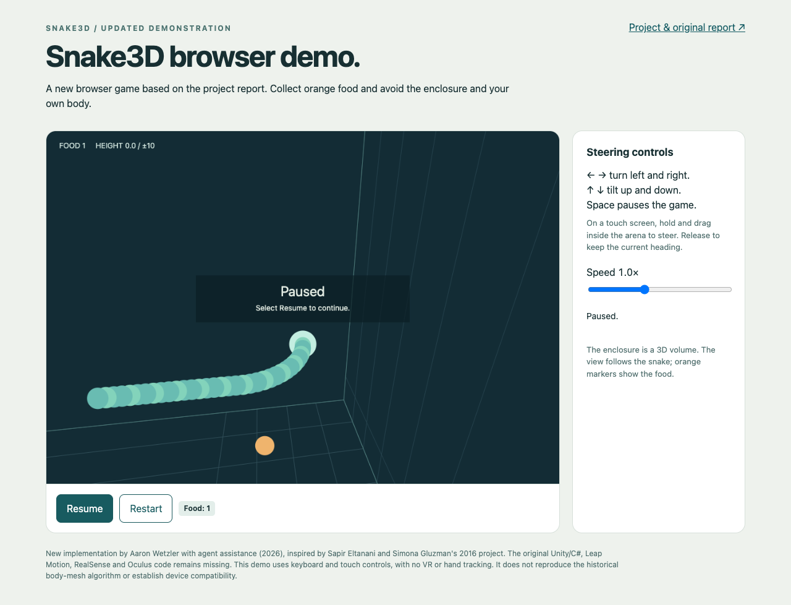

# Snake3D: updated work

## Updated work

**[Open the browser demo](https://twerdster.github.io/snake3d/)**

The **new browser game** provides a 3D enclosure, food, a growing snake and body/wall collisions with keyboard or touch steering. It is a new game based on the report, with no recovered Unity code, VR or hand-tracking integration.

[Browser demo guide](demo/README.md) describes local use, checks and limitations.

Historical project: Sapir Eltanani and Simona Gluzman; supervision: Aaron Wetzler. New implementations are labeled separately and do not change the preserved materials.

*Actual Chrome interface capture. Its input and execution scope are described above and in the demo guide.*
